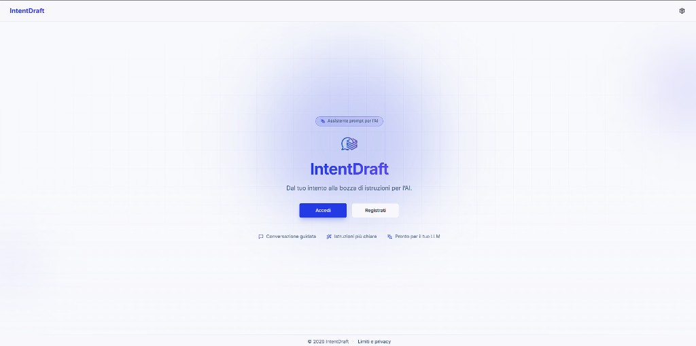
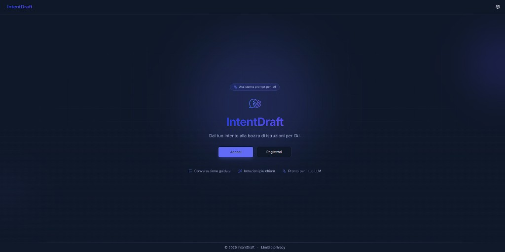
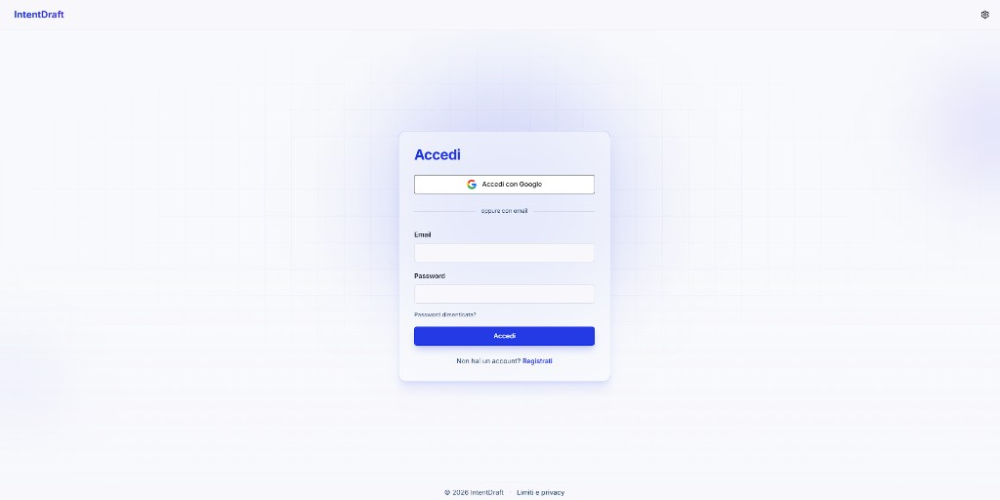
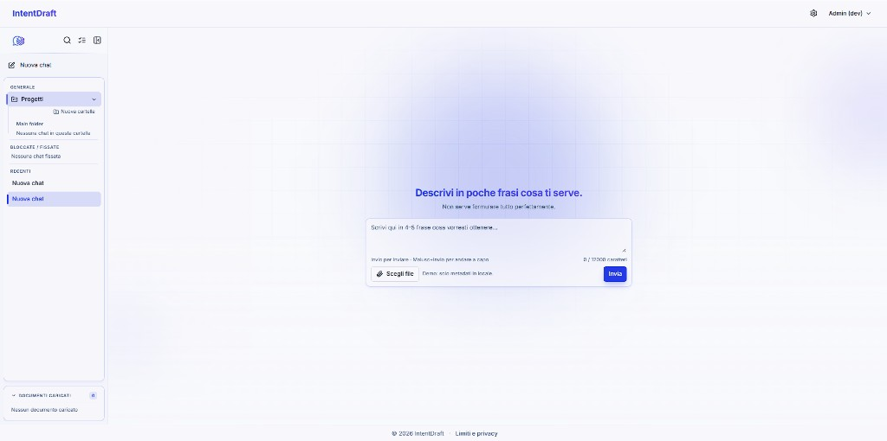
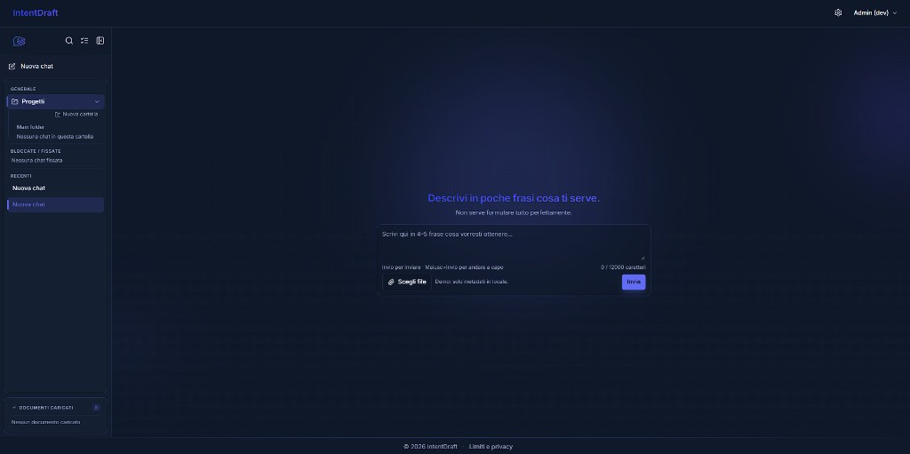
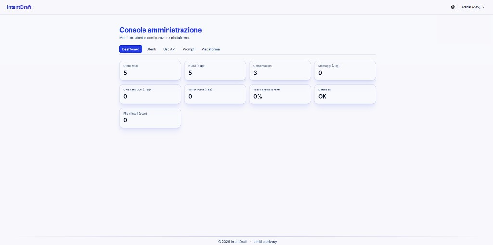
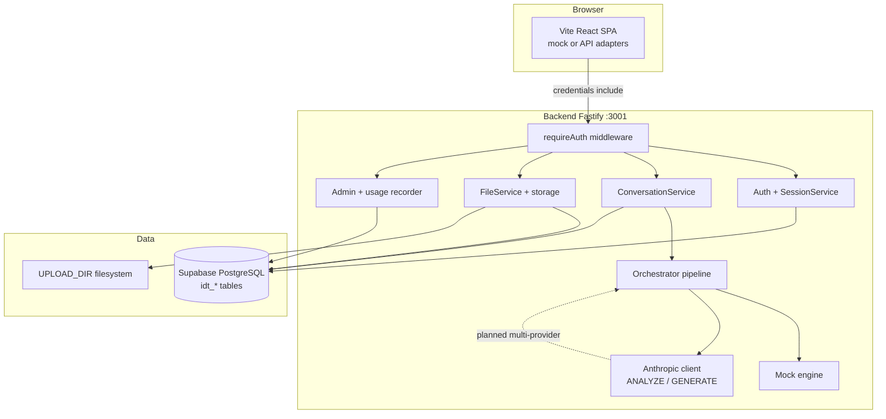

# IntentDraft

> **You describe what you want to achieve. IntentDraft interprets your intent, asks only what matters, engineers a structured prompt, and routes the work through server-side LLMs** — so you are not left pasting raw text into ChatGPT or Claude yourself.

**Full-stack monorepo:** a conversational SaaS for people who are **not** prompt-engineering experts. The user explains a need in natural language; the app runs a **three-phase pipeline** (intent and context → model selection → prompt engineering), persists conversations in the cloud, and returns a **copy-ready prompt artifact** plus an in-app clarification flow. API keys and model calls stay **server-side only**.

The repo is built as a **technical portfolio**: structured product docs, a shared FE/BE API contract, automated tests, a live Supabase database, and a documented path to multi-provider routing and public deploy.

---

## Table of contents

- [Problem and value](#problem-and-value)
- [UI preview](#ui-preview)
- [Features](#features)
- [Progress](#progress)
- [Skills and stack](#skills-and-stack)
- [Architecture](#architecture)
- [Frontend ↔ backend integration](#frontend--backend-integration)
- [Database and multi-tenancy](#database-and-multi-tenancy)
- [Cloud and deploy (planned)](#cloud-and-deploy-planned)
- [Local development](#local-development)
- [Testing and quality](#testing-and-quality)
- [Documentation](#documentation)
- [Repository layout](#repository-layout)

---

## Problem and value

| Aspect | Description |
| ------ | ----------- |
| **Problem** | Many people know *what* they want from an LLM but not *how* to instruct it (context, constraints, format, checks) → vague prompts, extra round-trips, and weak results. |
| **Beta target** | Generalists (email, notes, posts, everyday tasks); secondary audience: professionals and small teams. Personas in [`docs/product/requirements/product-requirements.md`](docs/product/requirements/product-requirements.md). |
| **Differentiation** | Not “longer prompts”, but **intent + explicit assumptions + decomposition** for complex tasks — with **orchestrated LLM calls** on the server instead of dumping the user’s first draft into a model. |
| **Business model (beta)** | Accounts and persistence; **no payments** in this phase; primary output remains a portable prompt text. Public cloud go-live and monetization are explicit roadmap items, not current scope. |

**How IntentDraft addresses the problem today**

1. **Intent and context detection** — the server analyzes the user message (and thread) into a structured `IntentModel` (objective, gaps, constraints, task type).
2. **Model routing (phase 1)** — with `LLM_ENABLED=true`, **Anthropic Claude** handles ANALYZE and GENERATE; with LLM off, the **server mock engine** preserves the same UX. **Multi-provider selection** (Claude / OpenAI / Gemini by task signals) is documented and planned — see [`docs/product/ai/llm-routing-strategy.md`](docs/product/ai/llm-routing-strategy.md).
3. **Prompt engineering** — a second server step composes a **PromptArtifact** (markdown, optional sections) tuned for downstream use.
4. **User-facing outcome** — clarification chat when needed, a “what I understood” panel, an editable prompt, copy/regenerate/skip — without exposing API keys or provider details in the browser.

The product is **not** an open-ended autonomous agent that runs arbitrary multi-step jobs in the background; it **does** replace the manual “write a prompt and paste it into an external tool” loop for the **comprehension and composition** layer, by forwarding the refined request to the configured LLM stack on the server.

Original concept: [`docs/concept/initial-brainstorming.md`](docs/concept/initial-brainstorming.md).

---

## UI preview

The frontend ships a **glassmorphism** shell with **light/dark** themes and **IT/EN** copy. Captures below match the current build (public landing → login → chat empty state → admin dashboard).

| Screen | Preview |
| ------ | ------- |
| **Landing** |  |
| **Landing (dark)** |  |
| **Login** |  |
| **Chat (empty)** |  |
| **Chat (dark)** |  |
| **Admin dashboard** |  |

**Landing** — Hero explains the product (“From your intent to a draft of instructions for AI”), with sign-in/register and three highlights: guided conversation, clearer instructions, ready for your LLM.

**Login** — Google OAuth plus email/password; links to registration and limits/privacy.

**Chat** — After auth, the sidebar lists projects, pinned/recent chats, and uploaded documents; the main pane prompts the user to describe their need in plain language (composer supports attachments and a 12k character limit).

**Admin** — Operators with the `admin` role open `/app/admin` for platform metrics (users, conversations, LLM usage, DB health).

Full captions and file index: [`docs/product/experience/screenshots/README.md`](docs/product/experience/screenshots/README.md) · UX journeys: [`docs/product/experience/user-journeys-and-ux.md`](docs/product/experience/user-journeys-and-ux.md) · Brand system: [`docs/product/experience/frontend-brand-ui.md`](docs/product/experience/frontend-brand-ui.md).

---

## Features

### User experience (frontend)

- **Landing and public pages** (glassmorphism brand, dark/light, IT/EN via i18next).
- **Register, login, logout** with validated forms (React Hook Form + Zod); **Google OAuth** when the API is configured (B8).
- **Chat area** (`/app`): conversation sidebar (new chat, rename, pin, project, delete), message thread, composer with attachments.
- **Conversation engine** — full UX in **mock mode** (`VITE_USE_MOCK=true`) or via **API + server orchestrator** (`VITE_USE_MOCK=false`): intent analysis, clarifying questions, interpretation panel, prompt editor, copy, regenerate, medical/legal refusals (logic ported to `backend/src/services/orchestrator/`).
- **Document preview** (PDF via pdf.js) and attachment download.
- **Profile settings** (API-backed profile and password).
- **Admin console** (`/app/admin`) for operators — usage, users, platform prompts (see [`docs/product/planning/admin-capabilities-plan.md`](docs/product/planning/admin-capabilities-plan.md)).
- **Routing:** HashRouter (static hosting / CDN friendly, no server-side rewrites).

### Backend API (implemented)

| Area | Endpoints (summary) | Notes |
| ---- | ------------------- | ----- |
| Health | `GET /api/health` | `{ ok, db }` — PostgreSQL ping |
| Auth | `POST /api/auth/register`, `login`, `logout`; `GET /api/auth/me`; Google OAuth routes | httpOnly signed cookie; sessions in DB |
| Conversations | CRUD `/api/conversations` | Strict `user_id` scope; JSON metadata (pin, project) |
| Messages | `POST /api/conversations/:id/messages` | Persists user + assistant turns; **orchestrator** (mock or Claude ANALYZE/GENERATE) |
| Prompts | latest, update, regenerate, skip-clarification, feedback | Versioned `idt_prmt` |
| Files | upload / list / delete / download | Multipart, MIME allowlist, size limit, `UPLOAD_DIR` filesystem |
| Admin | `/api/admin/*` | RBAC, LLM usage (`idt_usag`), audit, platform templates |

Detailed contract: [`docs/product/planning/frontend-implementation-spec.md`](docs/product/planning/frontend-implementation-spec.md) §8.

### Roadmap (documented; not all in production deploy)

- **Multi-provider routing** — `RoutingHints`, `LlmProvider` registry, second provider behind flags (R2–R5 in [`llm-routing-strategy.md`](docs/product/ai/llm-routing-strategy.md)).
- **INF** — Staging/prod deploy, CDN, object storage for uploads, WAF — [`docs/product/architecture/cloud-deployment-guide.md`](docs/product/architecture/cloud-deployment-guide.md).

Operational sequence: [`worklog.md`](worklog.md).

---

## Progress

| Milestone | Content | Status |
| --------- | ------- | ------ |
| **M0** | Health + Supabase PostgreSQL | Done |
| **M1** | Cookie auth + sessions | Done |
| **M2** | Persisted chat | Done |
| **M3** | File upload + download | Done |
| **M4** | Mock engine on API (server orchestrator, UX parity) | Done (B7) |
| **M5** | Claude server-side (`LLM_ENABLED`) | Done (B9) |
| **M6** | Public cloud deploy + global readiness | Documented; not implemented |

**Recommended demo modes**

| Mode | Setup |
| ---- | ----- |
| **Full UI / AI flow without backend** | `frontend` with `VITE_USE_MOCK=true` (default). |
| **Real auth, DB, files, orchestrator** | `VITE_USE_MOCK=false`, backend on `:3001` — threads and attachments on Supabase; mock engine by default, **Claude** when `LLM_ENABLED=true`. |

---

## Skills and stack

End-to-end **product design + software engineering**: MoSCoW requirements, ADRs, data schema, shared API contract, adapter pattern, integration tests against a real database.

### Frontend (`frontend/`)

| Technology | Use |
| ---------- | --- |
| **Vite 6**, **React 18**, **TypeScript** | SPA, build, type safety |
| **Tailwind CSS**, **Radix Slot**, **CVA** | UI system (from [react-typescript-template](https://github.com/luismalamoc/react-typescript-template)) |
| **React Router 7** (HashRouter) | Routing and protected app area |
| **Zustand** | Auth and conversation state |
| **i18next** | IT/EN localization |
| **Zod** + **React Hook Form** | Form validation |
| **pdfjs-dist** | PDF preview |
| **Vitest** | HTTP client tests |
| **Playwright** | Smoke E2E and responsive checks |

### Backend (`backend/`)

| Technology | Use |
| ---------- | --- |
| **Node.js 20+**, **Fastify 5** | REST API, CORS/cookie/multipart plugins |
| **TypeScript** | Auth, conversations, messages, files, admin, LLM |
| **Prisma 6** | ORM, migrations, types |
| **PostgreSQL (Supabase)** | Cloud persistence in development |
| **Anthropic SDK** | Server-side ANALYZE / GENERATE when enabled |
| **bcrypt** | Password hashing |
| **Zod** | Env and payload validation |
| **Vitest** | Unit + **integration tests** against `DATABASE_URL` |

### DevOps / data (current vs target)

- **Today:** Supabase PostgreSQL; API and FE locally; uploads on local disk; GitHub Actions CI.
- **Target (written guide):** Static FE on CDN, API on container/PaaS, secrets manager, object storage for files, edge rate limits, monitoring on `/api/health`.

---

## Architecture



Architectural decisions (monorepo, server-side cookie sessions, Prisma, separate Node API): [`docs/product/decisions/adr-001-stack-and-auth.md`](docs/product/decisions/adr-001-stack-and-auth.md).

Diagrams and phases: [`docs/product/architecture/technical-architecture.md`](docs/product/architecture/technical-architecture.md) · LLM routing: [`docs/product/ai/llm-routing-strategy.md`](docs/product/ai/llm-routing-strategy.md).

---

## Frontend ↔ backend integration

1. **Port pattern (light hexagonal):** the frontend uses **adapters** for mock vs API (`frontend/src/adapters/`), selected by `VITE_USE_MOCK` via `PortsProvider` — no scattered `fetch` calls.
2. **Single contract:** DTOs aligned between `frontend/src/types/api.ts` and backend mappers (`conversationDto`, `userMapper`, etc.).
3. **Auth:** httpOnly session cookie; API client with `credentials: 'include'`; CORS with explicit origin (`CORS_ORIGIN`).
4. **Bootstrap:** after login, **hydrate** conversation list from `GET /api/conversations` (IF-04).
5. **Files:** multipart upload; blob download with cookie (`fetchFileBlob`, document preview).

Operations map (OP-A* / IF-*): [`docs/product/architecture/frontend-backend-operations.md`](docs/product/architecture/frontend-backend-operations.md).

---

## Database and multi-tenancy

PostgreSQL tables use the compact prefix **`idt_*`**:

| Table | Role |
| ----- | ---- |
| `idt_user` | Account (local / Google) |
| `idt_sess` | Server-side sessions |
| `idt_conv` | Conversations + JSON metadata |
| `idt_msgs` | User / assistant / system messages |
| `idt_file` | Attachment metadata |
| `idt_prmt` | Versioned prompt artifacts |
| `idt_usag` | LLM usage events (admin) |
| `idt_adlg`, `idt_pptm`, … | Admin audit, platform prompts, config |

**Data isolation:** every conversation/file query is scoped by `user_id` from the session; cross-account access returns **404** (covered in integration tests).

ER definition and conventions: [`docs/product/architecture/database-design.md`](docs/product/architecture/database-design.md) · Prisma schema: [`backend/prisma/schema.prisma`](backend/prisma/schema.prisma).

---

## Cloud and deploy (planned)

The database is **already cloud-hosted** (Supabase). Publishing the API, frontend, and durable upload storage to production is still outstanding.

| Component | Local today | Cloud target |
| --------- | ----------- | ------------ |
| PostgreSQL | Supabase | Same project or dedicated prod env |
| Fastify API | `:3001` | HTTPS behind reverse proxy / PaaS |
| Frontend | Vite dev / `dist/` | CDN + static domain |
| Uploads | `./uploads` | Volume or S3-compatible + CDN |
| LLM providers | Anthropic (env) | Server env only — never exposed to the browser |

Checklist INF-001…006, cost notes, `Secure` cookies in prod, GDPR: [`docs/product/architecture/cloud-deployment-guide.md`](docs/product/architecture/cloud-deployment-guide.md).

---

## Local development

### Prerequisites

- Node.js **20+**
- Supabase project with `DATABASE_URL` in `backend/.env`
- `SESSION_SECRET` ≥ 32 characters, `PORT=3001`, `CORS_ORIGIN=http://localhost:5173`

### Backend

```bash
cd backend
cp .env.example .env
# set DATABASE_URL and SESSION_SECRET
npm install
npm run db:push   # or npm run db:migrate:deploy
npm run dev       # http://localhost:3001
```

Verify: `curl http://localhost:3001/api/health` → `{"ok":true,"db":true}`.

**Development admin account** (only when `NODE_ENV=development`): created/updated on API startup and via `npm run db:seed` in `backend/`. Defaults in [`backend/.env.example`](backend/.env.example):

| Field | Default |
| ----- | ------- |
| Email | `admin@intentdraft.local` |
| Password | `IntentDraft-Dev-Admin!` |

Override with `DEV_ADMIN_EMAIL`, `DEV_ADMIN_PASSWORD` in `backend/.env`. Disable with `DEV_ADMIN_ENABLED=false`. No automatic admin in production.

**Claude (optional):**

```env
LLM_ENABLED=true
ANTHROPIC_API_KEY=sk-ant-...
ANTHROPIC_MODEL=claude-sonnet-4-20250514
```

Supabase and migrations: [`backend/README.md`](backend/README.md).

### Frontend

```bash
cd frontend
cp .env.example .env
npm install
npm run dev       # http://localhost:5173
```

For the real API:

```env
VITE_USE_MOCK=false
VITE_API_URL=http://localhost:3001
```

### Both from repo root

```bash
npm install
npm run dev:all
```

### PM2 (dev — backend + frontend)

PM2 runs **two processes** in namespace `intentdraft`: `intentdraft-api` (Fastify) and `intentdraft-web` (Vite). Config: [`ecosystem.config.cjs`](ecosystem.config.cjs). The API loads `backend/.env` via `dotenv` on each start.

| Goal | Command (from root) |
| ---- | ------------------- |
| First-time install | `npm install` |
| Start stack | `pm2 start ecosystem.config.cjs` or `npm run pm2:start` |
| Restart API + frontend | `pm2 restart intentdraft --update-env` or **`npm restart`** |
| API only | `npm run pm2:restart:api` |
| Frontend only | `npm run pm2:restart:web` |
| Status / logs | `pm2 status` · `npm run pm2:logs` |
| Stop / remove | `pm2 stop intentdraft` · `npm run pm2:delete` |

If `pm2` is not on PATH (PowerShell): install globally `npm install -g pm2`, or use `npx pm2 restart intentdraft --update-env` / `npm restart`.

Do not run `npm run dev` on ports **3001** and **5173** while PM2 uses the same ports.

**Google login:** in API mode, “Sign in with Google” uses a **popup** (OAuth); when it completes, the session is established without a full-page reload.

---

## Testing and quality

| Suite | Command | Coverage |
| ----- | ------- | -------- |
| Backend unit | `cd backend && npm run test:unit` | Mock engine, LLM decide, env |
| Backend integration | `cd backend && npm run test:integration` | Auth, CRUD, files, rate limit (requires `DATABASE_URL`) |
| Backend CI locally | `cd backend && npm run ci` | lint + build + unit |
| Monorepo CI | `npm run ci` (root) | backend CI + frontend build/test |
| Frontend E2E | `cd frontend && npx playwright install chromium && npm run test:e2e` | Navigation smoke, responsive, API smoke when backend is up |

**GitHub Actions:** [`.github/workflows/ci.yml`](.github/workflows/ci.yml) — on PR/push to `main`: lint/build/unit; **integration** job with PostgreSQL 16 + `prisma migrate deploy`.

Operations: secret rotation → [`docs/ops/secrets-rotation-runbook.md`](docs/ops/secrets-rotation-runbook.md).

Prompt quality rubric and T-* cases: [`docs/product/quality/testing-and-evaluation.md`](docs/product/quality/testing-and-evaluation.md).

Approved FR/NFR: [`docs/product/requirements/product-requirements.md`](docs/product/requirements/product-requirements.md).

---

## Documentation

| Document | Content |
| -------- | ------- |
| [`docs/product/README.md`](docs/product/README.md) | Product spec index |
| [`worklog.md`](worklog.md) | Sprint status, B0–B11 checklist, manual tests |
| [`docs/product/planning/backend-implementation-plan.md`](docs/product/planning/backend-implementation-plan.md) | Backend plan |
| [`docs/product/planning/frontend-implementation-spec.md`](docs/product/planning/frontend-implementation-spec.md) | API contract and FE acceptance |
| [`docs/product/planning/beta-roadmap.md`](docs/product/planning/beta-roadmap.md) | FOUND / BETA roadmap |
| [`docs/product/ai/ai-prompt-engine-design.md`](docs/product/ai/ai-prompt-engine-design.md) | IntentModel and engine phases |
| [`docs/product/ai/llm-routing-strategy.md`](docs/product/ai/llm-routing-strategy.md) | Three-phase LLM routing |
| [`docs/product/experience/user-journeys-and-ux.md`](docs/product/experience/user-journeys-and-ux.md) | Journeys and UI states |

---

## Repository layout

```
IntentDraft/
├── frontend/          # Vite + React (UI, mock engine, API adapters)
├── backend/           # Fastify + Prisma + REST + orchestrator/LLM
├── docs/              # Concept, product spec, architecture, AI design
├── worklog.md         # Operational log and milestones
├── ecosystem.config.cjs  # PM2: api + web
└── package.json       # dev:all, pm2:*
```

---

## License

Frontend: MIT (see [`frontend/LICENSE`](frontend/LICENSE)). Rest of the monorepo: portfolio / personal project unless otherwise noted in the repo.

---

**IntentDraft** — from the idea in [`docs/concept/initial-brainstorming.md`](docs/concept/initial-brainstorming.md) to a technical beta with real persistence, a server-side conversation orchestrator, Anthropic integration, and a documented path to multi-LLM routing and cloud deploy.
