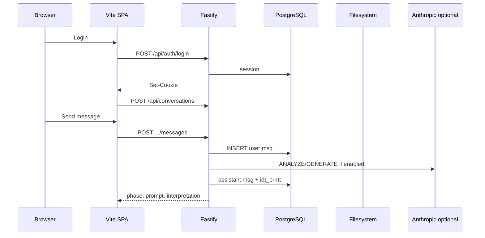

# Operazioni frontend ↔ backend — IntentDraft

**Documento:** `frontend-backend-operations.md`  
**Versione:** 1.1  
**Aggiornato:** 2026-11-01  
**Stack:** Vite React ↔ **Fastify** Node API + **Prisma** + **PostgreSQL (Supabase)** (CORS + credentials)  
**Stato:** operazioni **implementate** in repo; validazione pilota = test manuali [`../../../worklog.md`](../../../worklog.md)

---

## 1. Confini

| Layer                        | Responsabilità                                                                      |
| ---------------------------- | ----------------------------------------------------------------------------------- |
| **Frontend**                 | Pagine, form, i18n IT/EN, adapter mock/API, UI chat, admin (ruolo admin)            |
| **Backend**                  | Validazione, auth, PostgreSQL, storage file locale, orchestrator LLM/mock, admin API |
| **PostgreSQL**               | Utenti, sessioni, conversazioni, messaggi, file meta, prompt, usage LLM, admin    |

**Output prodotto:** testo prompt (`idt_prmt.body_markdown`) — nessuna esecuzione autonoma del task utente in-app (OQ-008 **Accepted**). Il server **invoca** Claude (o mock) per interpretazione e composizione.  
**Tabelle DB:** nomi fisici a 8 caratteri — vedi [`database-design.md`](database-design.md) §2.1.

---

## 2. Autenticazione

Meccanismo: **cookie di sessione httpOnly**; `ProtectedRoute` + bootstrap `GET /api/auth/me`.

| #      | Operazione                   | FE                        | BE                                                  | DB                                | Stato |
| ------ | ---------------------------- | ------------------------- | --------------------------------------------------- | --------------------------------- | ----- |
| OP-A01 | Registrazione email/password | Form + validazione client | `POST /api/auth/register`                           | INSERT `idt_user`                 | ✅    |
| OP-A02 | Login                        | Form                      | `POST /api/auth/login`                              | INSERT `idt_sess`                 | ✅    |
| OP-A03 | Logout                       | Pulsante                  | `POST /api/auth/logout`                             | DELETE `idt_sess`                 | ✅    |
| OP-A04 | Sessione corrente            | Bootstrap app             | `GET /api/auth/me`                                  | SELECT user by session            | ✅    |
| OP-A05 | Cambio lingua UI             | Settings / menu           | `PATCH /api/users/me` `{ locale }`                  | UPDATE `idt_user.locale`          | ✅    |
| OP-A06 | Google OAuth                 | Login popup/redirect      | `GET /api/auth/google`, callback                    | user `authProvider: google`       | ✅ (env) |
| OP-A07 | Forgot / reset password      | Pagine dedicate           | `POST /api/auth/forgot-password`, reset token       | email + hash                      | ✅    |

**Collaborazione FE↔BE:** FE non accede al DB; errori `{ code, message }` mappati in i18n.

---

## 3. Conversazioni e messaggi (orchestrator)

`POST .../messages` persiste il messaggio user e invoca l’**orchestrator** (mock engine o Anthropic ANALYZE/GENERATE).

| #      | Operazione             | FE               | BE                                     | DB                  | Stato |
| ------ | ---------------------- | ---------------- | -------------------------------------- | ------------------- | ----- |
| OP-C01 | Lista conversazioni    | Sidebar          | `GET /api/conversations`               | SELECT by `user_id` | ✅    |
| OP-C02 | Nuova conversazione    | Pulsante “Nuova” | `POST /api/conversations`              | INSERT              | ✅    |
| OP-C03 | Dettaglio + messaggi   | Chat             | `GET /api/conversations/:id`           | messages, ai_state  | ✅    |
| OP-C04 | Invio messaggio user   | Composer         | `POST /api/conversations/:id/messages` | INSERT + orchestrator | ✅  |
| OP-C05 | Patch titolo/metadata  | Sidebar menu     | `PATCH /api/conversations/:id`         | pin, project, title | ✅    |
| OP-C06 | Elimina conversazione  | Modale           | `DELETE /api/conversations/:id`        | CASCADE             | ✅    |
| OP-C07 | Rigenera prompt        | UI chat          | `POST .../regenerate`                  | nuova `idt_prmt`    | ✅    |
| OP-C08 | Salta chiarimenti      | UI chat          | `POST .../skip-clarification`          | orchestrator        | ✅    |

---

## 4. Prompt (output testuale)

| #      | Operazione                    | FE              | BE                                                     | Stato |
| ------ | ----------------------------- | --------------- | ------------------------------------------------------ | ----- |
| OP-P01 | Visualizza ultimo prompt      | Editor          | GET conversation / `.../prompts/latest`                | ✅    |
| OP-P02 | Salva modifica manuale prompt | Editor debounce | `PUT /api/prompts/:id`                                 | ✅    |
| OP-P03 | Rigenera prompt               | Pulsante        | `POST .../regenerate`                                  | ✅    |
| OP-P04 | Copia negli appunti           | Solo FE         | —                                                      | ✅    |
| OP-P05 | Feedback utile/non utile      | Thumb           | `POST /api/prompts/:id/feedback`                       | ✅    |

---

## 5. Upload file

| #      | Operazione                   | BE / FS                                       | Stato |
| ------ | ---------------------------- | --------------------------------------------- | ----- |
| OP-F01 | Upload multipart             | `POST /api/conversations/:id/files`           | ✅    |
| OP-F02 | Lista file                   | `GET /api/conversations/:id/files`            | ✅    |
| OP-F03 | Elimina file                 | `DELETE /api/files/:id`                       | ✅    |
| OP-F04 | Download file                | `GET /api/files/:id/download` (cookie)        | ✅    |

---

## 6. Admin (ruolo `admin`)

Operazioni `/api/admin/*` — metriche, utenti, usage LLM, template prompt, legal/cookie. Vedi [`../planning/admin-capabilities-plan.md`](../planning/admin-capabilities-plan.md).

---

## 7. Health e config

| #      | Operazione        | BE                | Note                         |
| ------ | ----------------- | ----------------- | ---------------------------- |
| OP-H01 | Health check      | `GET /api/health` | `{ ok, db }`                 |
| OP-H02 | LLM               | env               | `LLM_ENABLED`, `ANTHROPIC_*` |

---

## 8. Sequenza tipica — utente autenticato (API mode)

---

## 9. Tracciabilità roadmap

| Blocco doc storico | Stato repo |
| ------------------ | ---------- |
| FOUND-013–014 auth | ✅         |
| FOUND-020–021 chat | ✅         |
| FOUND-035 file     | ✅         |
| BETA-050+ chat UX  | ✅ (mock + API) |
| BETA-060+ LLM      | ✅ (B9)    |

Prossimo passo operativo: verifiche manuali — [`../../../worklog.md`](../../../worklog.md) § analisi gap.
