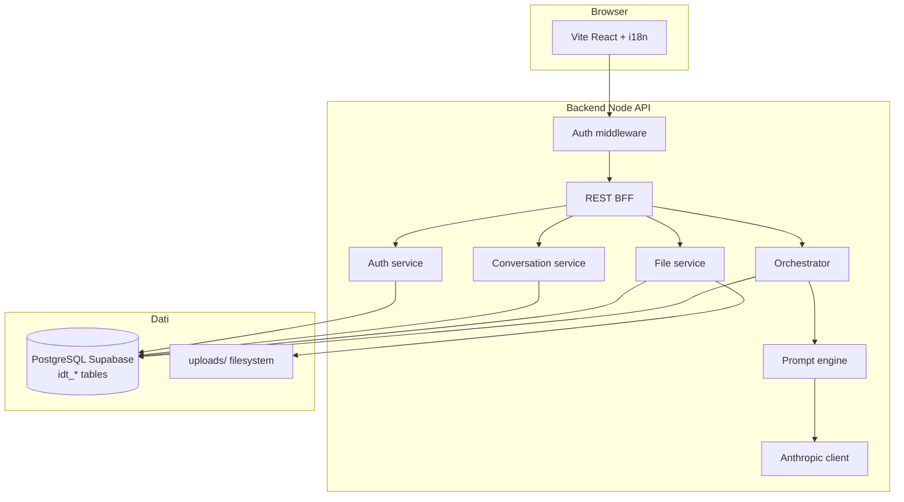

# Architettura tecnica — IntentDraft (beta)

**Documento:** `technical-architecture.md`  
**Versione:** 1.2  
**Aggiornato:** 2026-11-01  
**Stack:** **Accepted** — **Frontend** Vite/React/TS ([template](https://github.com/luismalamoc/react-typescript-template)) · **Backend** Fastify + **Prisma** + **PostgreSQL (Supabase)** · **Auth** cookie + tabella `idt_sess` (ADR-001)  
**LLM:** Anthropic **Claude Sonnet** (OQ-002) — **implementato** (`LLM_ENABLED`); fallback mock server-side

---

## 1. Stato attuale

Monorepo **operativo**: `frontend/` (SPA + adapter mock/API), `backend/` (REST + orchestrator + admin), DB Supabase, CI GitHub Actions. Milestone implementative **M0–M5** completate in codice; **M6** (deploy cloud) e **verifiche manuali** pilota in corso — vedi [`../../../worklog.md`](../../../worklog.md).

Emendamenti rispetto ai doc 2026-10-25: [`../decisions/implementation-amendments.md`](../decisions/implementation-amendments.md).

---

## 2. Architettura target — fasi

| Fase               | Contenuto                                                | Stato (2026-11-01)   |
| ------------------ | -------------------------------------------------------- | -------------------- |
| **1 — Fondamenta** | Auth, PostgreSQL, CRUD conversazioni, upload file, i18n | **Fatto** (B0–B5)    |
| **2 — UI shell**   | Template OQ-013 + chat + settings + admin                | **Fatto**            |
| **3 — Motore AI**  | Orchestrator mock (M4) + Anthropic (M5)                  | **Fatto**            |
| **4 — Deploy**     | Staging/prod, CDN, object storage                        | **Documentato; non deployato** (INF) |

---

## 3. Diagramma logico (completo)



**Runtime:** con `LLM_ENABLED=false`, l’orchestrator usa il **mock engine** server-side (parità UX M4). Con `LLM_ENABLED=true`, ANALYZE/GENERATE via Anthropic.

---

## 4. Responsabilità componenti

| Componente               | Responsabilità                                                   |
| ------------------------ | ---------------------------------------------------------------- |
| **UI**                   | Login/register, chat, editor prompt, upload, copia, locale IT/EN |
| **Middleware**           | Protezione route; redirect se non autenticato                    |
| **Auth service**         | Register/login/logout, sessioni, hash password (NFR-012)         |
| **Conversation service** | CRUD conversazioni/messaggi per `user_id`                        |
| **File service**         | Upload validato → filesystem + metadati PostgreSQL               |
| **Orchestrator**         | Pipeline messaggi, chiarimenti, prompt, refusal (mock o LLM)     |
| **Admin module**         | Metriche, utenti, template prompt, usage LLM (`idt_usag`)        |
| **Prompt engine**        | IntentModel, generazione **testo prompt**                        |
| **Anthropic client**     | Chiamate Sonnet solo server-side (NFR-001)                       |

Dettaglio operazioni FE↔BE: `frontend-backend-operations.md`.  
Schema DB: `database-design.md`.

---

## 5. Flusso dati — persistenza e file (sempre attivo)

1. Utente autenticato (cookie sessione).
2. `POST /api/conversations` → riga in PostgreSQL.
3. Upload → file su disco + `idt_file`.
4. `GET /api/conversations/:id` → messaggi, file, `ai_state`, ultimo prompt.

---

## 6. Flusso dati — conversazione AI (M4/M5)

1. `POST .../messages` → INSERT messaggio user.
2. Orchestrator: analisi intento → (opzionale) chiarimenti → generazione prompt.
3. Con LLM: `ANALYZE` → `GENERATE` (Anthropic); altrimenti mock engine rule-based.
4. INSERT messaggio assistant + versione `idt_prmt`; FE stati `analyzing` / `clarifying` / `prompt_ready`.
5. Output principale = **testo prompt** copiabile (OQ-008); chiavi API solo server-side.

---

## 7. Motore AI e routing LLM

IntentDraft inserisce un **core product** tra l’utente e l’LLM: interpretazione intento, gap, chiarimenti, prompt engineering. Flusso a tre fasi: Intent & context → model selection → prompt engine (vedi [`../ai/llm-routing-strategy.md`](../ai/llm-routing-strategy.md)).

### 7.1 Integrazione Anthropic (fase attuale)

| Aspetto         | Scelta                                        |
| --------------- | --------------------------------------------- |
| Modello         | **Claude Sonnet** (`ANTHROPIC_MODEL`)         |
| Chiamate        | Solo server-side (`ANALYZE` / `GENERATE`)     |
| Dev locale      | `LLM_ENABLED=false` fino a chiave configurata |
| Retry / timeout | NFR-002                                       |

**Roadmap:** selezione automatica tra più provider (Claude, Gemini, OpenAI) in base a `IntentModel` + policy admin — dettaglio in [`../ai/llm-routing-strategy.md`](../ai/llm-routing-strategy.md) e [`../ai/ai-prompt-engine-design.md`](../ai/ai-prompt-engine-design.md).

---

## 8. Configurazione locale

```env
DATABASE_URL=postgresql://...   # Supabase
SESSION_SECRET=...
CORS_ORIGIN=http://localhost:5173
UPLOAD_DIR=./uploads
MAX_UPLOAD_BYTES=...
LLM_ENABLED=false               # true + ANTHROPIC_API_KEY per M5
ANTHROPIC_API_KEY=
```

---

## 9. Persistenza

| Dato                           | Store                                                      |
| ------------------------------ | ---------------------------------------------------------- |
| Utenti, sessioni, chat, prompt, usage admin | **PostgreSQL (Supabase)**                  |
| File binari                    | **Filesystem** locale                                      |
| Log                            | No contenuto chat in prod (NFR-005) — quando in produzione |

---

## 10. Sicurezza (fase corrente)

- Password hash (bcrypt/argon2).
- Cookie httpOnly, Secure in produzione futura.
- Upload: allowlist MIME, max size, path sanitization, ownership check.
- Prepared statements / ORM per SQL injection.
- Prompt injection: rilevante quando testo file entra nel contesto LLM — fase AI.

---

## 11. Deployment

**Ora:** solo **localhost** — nessun hosting richiesto (founder).

**Futuro:** OQ-012 — da ripianificare (EU/US, GDPR).

---

## 12. Struttura repository (attuale)

```
IntentDraft/
  frontend/          # Vite React SPA
  backend/           # Fastify, prisma/, src/modules/, orchestrator, llm/
  docs/
  worklog.md
  ecosystem.config.cjs
```

---

## 13. ADR e registro emendamenti

| Riferimento | Titolo |
| ----------- | ------ |
| ADR-001 | [`adr-001-stack-and-auth.md`](../decisions/adr-001-stack-and-auth.md) — Vite + Node API + Prisma PostgreSQL |
| ADR-002 | Anthropic Sonnet — sintesi in [`implementation-amendments.md`](../decisions/implementation-amendments.md) §4 |
| — | [`implementation-amendments.md`](../decisions/implementation-amendments.md) — MySQL→Postgres, stato B0–B10 |

---

## 14. Trade-off

| Scelta        | Pro                  | Contro                 |
| ------------- | -------------------- | ---------------------- |
| Vite + API separata | Template UI, segreti solo BE | Due processi dev |
| Supabase Postgres | DB cloud subito, migrazioni Prisma | Vendor lock-in moderato |
| LLM flag + mock fallback | Demo senza costo API; test deterministici | Due code path da mantenere |
| File su disco | Semplice localhost   | Da sostituire con object storage in INF |
