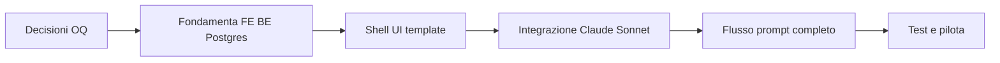

# Roadmap verso la prima beta — IntentDraft

**Documento:** `beta-roadmap.md`  
**Versione:** 1.2  
**Stato:** decisioni founder (2026-10-25) · **implementazione B0–B10 + admin completata in repo (2026-10-31)**  
**Nota:** molte checkbox sotto erano pianificazione pre-codice; stato reale → [`../../../worklog.md`](../../../worklog.md) + [`../decisions/implementation-amendments.md`](../decisions/implementation-amendments.md). **Prossimo:** verifiche manuali e fase test pilota (non scaffold FOUND).

Legenda priorità: **P0** critico | **P1** alto | **P2** medio

---

## Percorso critico (sintesi)

**Parallelo possibile:** i18n (FOUND-015) con auth; scelta template (FOUND-040) quando vuoi.

**Nota:** LLM (**BETA-060+**) **dopo** FOUND-* — allineato a founder.

**Legenda checklist:** `[X]` completato · `[ ]` da fare

---

## Fase 0 — Progettazione documentale ✅

**Obiettivo:** analisi e specifiche pre-implementazione (senza codice applicativo).  
**Stato:** completata (2026-10-25).

- [X] PLAN-001 — `repository-assessment.md` — **P0**
- [X] PLAN-002 — `product-requirements.md` (FR/NFR, MoSCoW) — **P0**
- [X] PLAN-003 — `user-journeys-and-ux.md` (3 scenari) — **P0**
- [X] PLAN-004 — `technical-architecture.md` — **P0**
- [X] PLAN-005 — `ai-prompt-engine-design.md` — **P0**
- [X] PLAN-006 — `testing-and-evaluation.md` — **P0**
- [X] PLAN-007 — `beta-roadmap.md` — **P0**
- [X] PLAN-008 — `open-questions-and-decisions.md` — **P0**
- [X] PLAN-009 — Verifica coerenza requisiti ↔ test ↔ roadmap — **P0**
- [X] PLAN-010 — Indice `docs/product/README.md` — **P1**
- [X] PLAN-011 — Allineamento tabelle Markdown (`scripts/align_markdown_tables.py`) — **P2**
- [X] PLAN-012 — Integrazione decisioni founder in documentazione — **P0**
- [X] PLAN-013 — `database-design.md` — **P0**
- [X] PLAN-014 — `frontend-backend-operations.md` — **P0**

**DoD:** pacchetto `docs/product/` completo; nessuna dipendenza runtime aggiunta.

---

## Fase 1 — Discovery e repository ✅

**Obiettivo:** capire cosa esiste.  
**Stato:** completata (2026-10-25).

- [X] BETA-001 — Ispezionare struttura repo e documenti (`repository-assessment.md`) — **P0**
- [X] BETA-002 — Allineare concept da [`../../concept/initial-brainstorming.md`](../../concept/initial-brainstorming.md) — **P0**
- [X] BETA-003 — Produrre pacchetto documentazione `docs/product/` — **P0**

**DoD:** documenti 1–8 presenti e incrociati.

---

## Fase 2 — Decisioni prodotto essenziali ✅

**Obiettivo:** sbloccare implementazione.  
**Stato:** completata (2026-10-25).

- [X] BETA-010 — **OQ-001** Next.js + TypeScript — **P0**
- [X] BETA-011 — **OQ-002** Anthropic Claude Sonnet (integrazione **rinviata**) — **P0**
- [X] BETA-012 — **OQ-003** persistenza **DB + account** (PostgreSQL Supabase) — **P1**
- [X] BETA-013 — **OQ-005** localhost / solo team — **P0**
- [X] BETA-014 — **OQ-008** output solo prompt testuale — **P1**
- [X] BETA-015 — Scope beta: **Must** auth + upload; **Won't** pagamenti (ora) — **P1**

**DoD:** [`../decisions/open-questions-and-decisions.md`](../decisions/open-questions-and-decisions.md) v1.2.

---

## Fase 3 — Requisiti e UX (documentazione)

**Obiettivo:** baseline congelata per dev.

- [X] BETA-020 — Review founder `product-requirements.md` — **P1**
- [ ] BETA-021 — Review founder scenari UX (opzionale) — **P2**
- [X] BETA-022 — Pilota semplice: **notes** + **post LinkedIn** — **P1**

**DoD:** EV-01/EV-02 aggiornati in `testing-and-evaluation.md`.

---

## Fase 4 — Implementazione fondamenta (priorità attuale)

**Obiettivo:** frontend + backend + PostgreSQL per operazioni basilari.  
**Stato:** **[X] implementato** (B0–B5); validazione manuale in corso.

- [X] FOUND-010 — Monorepo `frontend/` + `backend/` — **P0**
- [X] FOUND-011 — Prisma + PostgreSQL (Supabase) + `.env.example` — **P0**
- [X] FOUND-012 — Migrazioni schema v1 (`idt_*`) — **P0**
- [X] FOUND-013 — Auth register/login/logout/me — **P0** — FR-021
- [X] FOUND-014 — Route protette + login/register — **P0**
- [X] FOUND-015 — i18n IT/EN — **P0** — FR-024
- [X] FOUND-020 — CRUD conversazioni UI + API — **P0** — FR-022
- [X] FOUND-021 — API messaggi + orchestrator — **P0**
- [X] FOUND-022 — Test integrazione auth + conversazione — **P1**
- [X] FOUND-035 — Upload file multipart — **P0** — FR-023
- [X] FOUND-036 — UI allegati + delete — **P1**
- [X] FOUND-040 — Template UI — **P1**
- [X] FOUND-041 — Template adattato — **P1**

**DoD:** flusso OP-A + OP-C + OP-F verde in locale — **verificare** con worklog §18.

---

## Fase 5 — Architettura contratti AI (pre-codice LLM)

**Dipende da:** FOUND-010.

- [X] BETA-030 — Tipi IntentModel / PromptArtifact (backend `llm/intentModel.ts` + FE DTO) — **P0**
- [X] BETA-031 — Schema allineato ad `ai-prompt-engine-design.md` — **P0**
- [X] BETA-032 — Contratto API messaggi/regenerate/skip — **P0**
- [X] BETA-033 — Documentazione avvio (README, backend/README, worklog) — **P0**
- [X] BETA-034 — Anthropic 2-step — **P1** (vedi `implementation-amendments.md` §4)

**Verifica:** contratti TypeScript + mock MSW.

---

## Fase 6 — Moduli server (pre-LLM e LLM)

**Dipende da:** FOUND-011, BETA-030.

- [X] BETA-040 — Modulo `llm/` Anthropic + flag — **P0** — NFR-002
- [X] BETA-041 — Validazione zod env/payload — **P0** — NFR-004
- [X] BETA-042 — CI GitHub Actions — **P1**
- [X] BETA-043 — Health endpoint — **P2**

---

## Fase 7 — Flusso principale UI (chat + prompt)

**Dipende da:** FOUND-020+, BETA-040, integrazione LLM attiva.

- [X] BETA-050 — Layout chat + composer — **P0**
- [X] BETA-051 — Pannello “Cosa ho capito” — **P0**
- [X] BETA-052 — Chiarimenti + skip — **P0**
- [X] BETA-053 — Editor prompt + Copia/Rigenera — **P0**
- [X] BETA-054 — Stati loading/error UX — **P0** _( `error_fatal` UI: gap minore)_
- [X] BETA-055 — Edge case vuoto/limite — **P0**
- [X] BETA-056 — Responsive base (Playwright) — **P1**

**DoD:** T-E2E-01, T-E2E-03 verdi con LLM mock.

---

## Fase 8 — Motore AI (Claude Sonnet)

**Dipende da:** BETA-031, BETA-040, FOUND completata.

- [X] BETA-060 — ANALYZE + IntentModel — **P0**
- [X] BETA-061 — Policy turni/domande — **P0**
- [X] BETA-062 — GENERATE + PromptArtifact — **P0**
- [X] BETA-063 — Refusal fuori scope — **P0**
- [X] BETA-064 — Rigenerazione — **P1**
- [X] BETA-065 — Test T-CONV, T-PROMPT unit — **P1** _(catalogo EV file: da creare)_

**DoD:** T-CONV-01..04, T-PROMPT-01..03 verdi.

---

## Fase 9 — Errori, sicurezza, privacy, costi

**Dipende da:** BETA-040, BETA-050.

- [X] BETA-070 — Rate limiting (NFR-003) — **P0**
- [X] BETA-071 — Logging senza contenuto (NFR-005) — **P0**
- [X] BETA-072 — Pagina “Limiti e privacy” (FR-016) — **P0** _(allineare copy i18n API mode)_
- [X] BETA-073 — Metriche token/costo (NFR-010) — **P1** (`idt_usag`)
- [ ] BETA-074 — Audit manuale no secret in client (NFR-001) — **P0**

**DoD:** T-SEC-02, checklist G4.

---

## Fase 10 — Test e valutazione

**Dipende da:** Fase 6–8.

- [X] BETA-080 — Suite unit/integration backend — **P0**
- [X] BETA-081 — Playwright smoke + smoke-api — **P0** _(T-E2E completi in CI: gap)_
- [X] BETA-082 — T-ERR, T-SEC parziali in integration/unit — **P0**
- [ ] BETA-083 — Creare `backend/tests/fixtures/eval/` EV-01..15 — **P1**
- [ ] BETA-084 — Sessione rubric con 2 revisori — **P1**
- [ ] BETA-085 — Confronto baseline vs IntentDraft — **P1**
- [ ] BETA-086 — Feedback utile/non utile (FR-017) — **P2**

**DoD:** Gate G1–G3 (`testing-and-evaluation.md`).

---

## Fase 11 — Beta interna (localhost / team)

**Dipende da:** BETA-080–082, BETA-072.

- [ ] BETA-090 — Ambiente demo locale documentato (no cloud obbligatorio) — **P0**
- [ ] BETA-091 — Smoke test end-to-end locale — **P0**
- [ ] BETA-092 — Dogfooding team/founder (≥10 sessioni) — **P1**
- [ ] BETA-093 — Triage bug P0/P1 — **P0**

---

## Fase 12 — Beta pilota utenti

**Dipende da:** BETA-090, BETA-084.

- [ ] BETA-100 — Reclutare 5–10 utenti target (P1 persona) — **P1**
- [ ] BETA-101 — Script onboarding + consenso uso dati — **P0**
- [ ] BETA-102 — Raccolta metriche completamento/copia — **P1**
- [ ] BETA-103 — Interviste brevi post-uso — **P1**

---

## Fase 13 — Go/No-Go e retrospettiva

- [ ] BETA-110 — Checklist beta pronta (sezione sotto) — **P0**
- [ ] BETA-111 — Decisione Go/No-Go founder — **P0**
- [ ] BETA-112 — Retro documentata + backlog post-beta — **P1**

---

## Checklist — Beta pronta

- [ ] Tutti FR **Must** implementati (tracciabilità `product-requirements.md` §17)
- [ ] NFR-001, NFR-002, NFR-003, NFR-004, NFR-005, NFR-009 verificati
- [ ] Gate G1–G5 qualità
- [ ] Auth + PostgreSQL + upload **verificati manualmente** (FOUND)
- [X] LLM Sonnet integrato con chiavi solo server-side (NFR-001) — codice
- [ ] Informativa limiti/privacy pubblicata
- [ ] Runbook incidenti minimi (rotazione chiave API)
- [ ] Nessun P0 bug aperto

---

## Criteri Go / No-Go

| Go                                     | No-Go                       |
| -------------------------------------- | --------------------------- |
| ≥70% casi EV pass rubric               | <50% pass                   |
| Baseline vinta/pareggiata ≥70%         | Perdita netta vs baseline   |
| Flusso copia completato da ≥80% pilota | Abbandono precoce sistemico |
| Costo/sessione entro budget OQ-002     | Costi fuori controllo       |

---

## Problemi che bloccano il rilascio

1. Chiavi API esposte (NFR-001).  
2. Auth assente o upload non sicuro (file path traversal).  
3. Test E2E Must rossi in CI.  
4. Mancanza informativa trattamento dati verso LLM (FR-016).  
5. Refusal categorie ad alto rischio non funzionante (FR-012).

---

## Miglioramenti post-beta (backlog)

- Libreria prompt locali (OQ-011)
- Export .txt / Markdown download
- Scelta modello UI
- Pagamenti (OQ-007)
- Hosting e GDPR (OQ-012)
- Template verticali marketing/report
- Esecuzione integrata task (sempre fuori scope attuale)

---

## Prossimo passo implementativo

**Fase test pilota (locale):** checklist §18 FE spec + worklog (verifiche API mode, B9 LLM reale, rubric EV). Vedi [`../../../worklog.md`](../../../worklog.md) § analisi gap §H–§I. **Deploy cloud:** dopo pilota (INF / M6).

---

## Tracciabilità requisiti Must → task

| FR / NFR   | Task                 |
| ---------- | -------------------- |
| FR-021     | FOUND-010–014        |
| FR-022     | FOUND-020–021        |
| FR-023     | FOUND-035–036        |
| FR-024     | FOUND-015            |
| NFR-012–13 | FOUND-011–012        |
| FR-001+    | BETA-050+ (post LLM) |
| FR-006–010 | BETA-053, BETA-062+  |
| FR-016     | BETA-072             |
| NFR-001    | BETA-040, BETA-074   |
